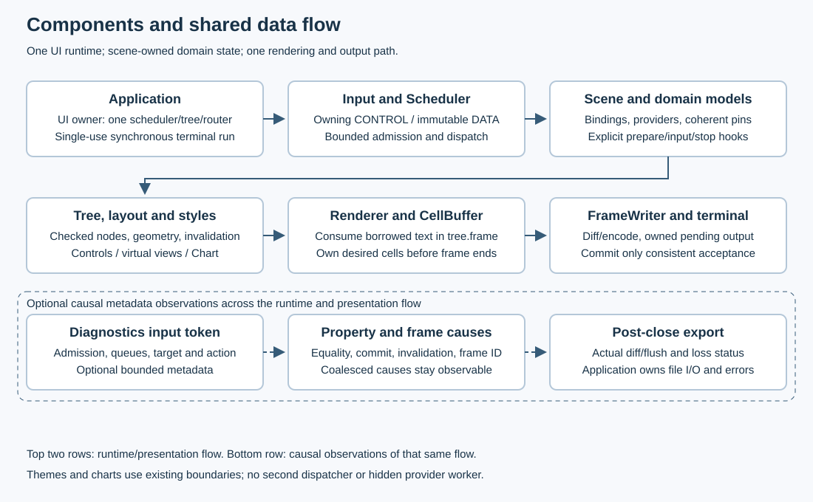
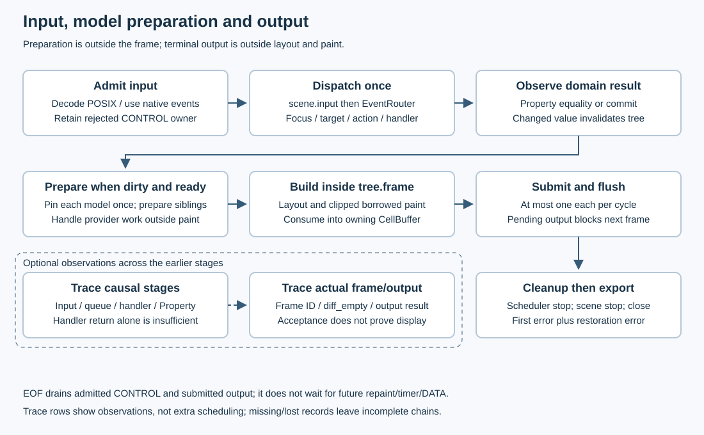
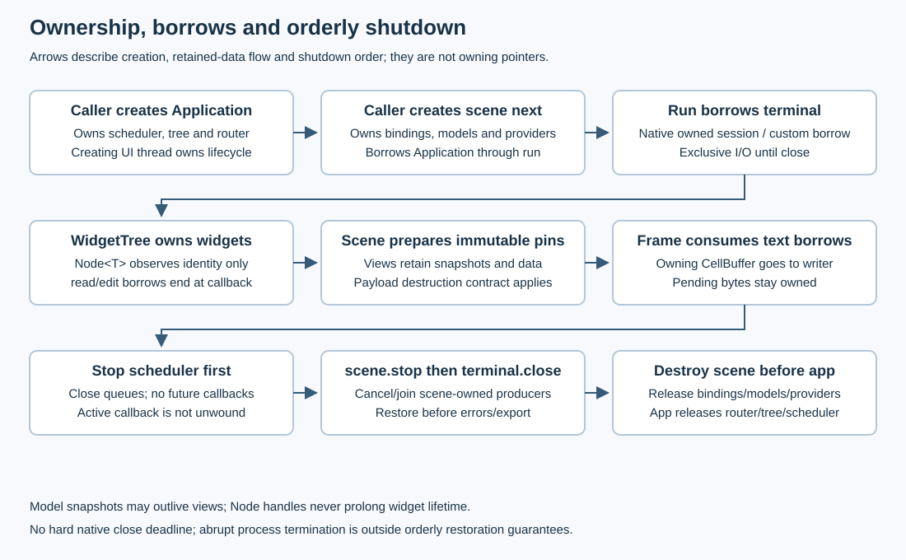

# Architecture {#architecture}

Portals is a C++23 retained terminal UI library. `Application` owns one UI
runtime and services its terminal synchronously on the creating thread. The
scene owns application models, scoped bindings and providers. Workers may
publish immutable data through bounded scheduler endpoints; they cannot edit
the widget tree. [Getting started](getting-started.md) links a simple main and
the runnable examples; [limitations](limitations.md) defines release boundaries.

## Components and boundaries

| Component | Implemented responsibility |
|---|---|
| `Application` | Own scheduler/tree/router; coordinate bounded input, dispatch, preparation, frames, output and orderly cleanup |
| `ApplicationScene` | Borrow UI services; own domain models/bindings/providers; synchronize and prepare views; stop owned producers |
| `TerminalSession` / `InputDecoder` | Native bounded I/O and semantic input; Windows events are not decoded twice |
| `Scheduler` | Separate CONTROL/DATA capacities and dispatch budgets; timers, publication and scoped cancellation |
| `EventRouter` | Focus, hit testing, action resolution and checked delivery through the existing dispatcher |
| `WidgetTree` | Own widget storage, identities, geometry and invalidation; expose checked callback borrows |
| `Property<T>` / `Model<T>` | Immutable value/revision and snapshots; explicit observers, scoped ranges and request receipts |
| Layout, controls, virtual views, `Chart<T>` | Measure/arrange/paint; prepare coherent bounded presentation before frames |
| Typed themes / PSS v0 | Resolve styles and apply validated atomic theme updates; no second rendering path |
| Renderer / `CellBuffer` | Consume clipped borrowed commands into owning desired cells inside the frame |
| `FrameWriter` | Encode/diff, retain pending output, advance committed state only after consistent acceptance |
| `Diagnostics` | Optional bounded causal metadata; owning snapshot and export chosen by the application |

The core uses standard-library and native OS interfaces. Grapheme processing
uses the private vendored utf8proc dependency. Doxygen, fuzzers and test oracles
are build tools, not runtime dependencies. See [text](text.md), [render](render.md),
[terminal](terminal.md), [styles](styles.md) and [chart](chart.md).

## One event loop, explicit service bounds

`Application::run` coordinates the loop; `Scheduler::dispatch` performs one
bounded dispatch and starts no thread. Each service cycle admits bounded input,
dispatches once, prepares/renders a ready dirty frame at most once, and services
pending output at most once. One native batch/raw suffix and one rejected CONTROL
owner survive admission pressure. Input is retained rather than silently dropped.
Windows supplies decoded events; POSIX bytes retain arrival timestamps for
streaming decoder deadlines.

The native terminal read is the wait primitive. Positive `inputSlice` deadlines
also bound when worker publications are serviced; scheduler `waitFor` is not a
universal wait covering native terminal I/O. Pending output prevents another
submission, leaving dirty state in the tree. Frame cadence is measured from actual
submission/completion; late work causes no catch-up burst. Idle samples input and
resize, but emits no periodic frame without invalidation.

CONTROL and DATA have separate capacities and budgets. `REPLACE_LATEST` can
coalesce a complete display snapshot for the same sender. Lossless domain
aggregation must happen first: dropping a display snapshot is different from
dropping a financial tick. The dashboard aggregates each generated tick into
OHLC before publication; its provider runs on the UI thread. Queue bounds limit
retained owners, not arbitrary payload bytes or callback duration.
See [scheduler](scheduler.md) and [Application](application.md).

## From input and models to output

1. Admission creates a diagnostic input token when tracing is enabled, then
   publishes an owning CONTROL payload. The queued token survives dispatch.
2. `scene.input` may handle a global command; otherwise EventRouter resolves
   focus/hit target and action, then invokes the checked handler.
3. Property assignment compares immutable values. An equal value creates no
   new invalidation; a changed value invalidates and queues observers. A successful
   property receipt can still report notification rejections.
4. When a dirty frame can be submitted, `scene.prepare` synchronizes bindings
   and takes one pin per model. Sibling table/chart views prepare from that pin
   at their final extents. Provider request receipts are handled outside painting.
5. Inside `WidgetTree::frame`, Application lays out and paints visible nodes,
   translating local commands through arranged surfaces and clips. The renderer
   consumes every borrowed text command into an owning CellBuffer before returning.
6. FrameWriter receives that buffer and the actual frame token. Diff/encoding and
   bounded flush happen outside layout/paint. Partial output stays owned; committed
   state advances only on complete consistent acceptance.

A paint/preparation/render failure ends the run with its original component
cause; Application does not replace failed widgets with an implicit placeholder.
The tree alone does not roll back earlier paint submissions. No partially built
frame is submitted by the runner on failure.

The causal chain records queue admission/dispatch, target/action, handler and
Property evidence, invalidation/frame ID, and actual diff/output outcomes.
Coalesced causes can share a frame; the frame token identifies its first recorded
cause rather than an unbounded cause list. Handler return proves neither a domain
change nor a displayed frame. A real update can produce an empty diff.
Transport acceptance proves no physical display. Ring losses and incomplete
chains remain explicit. [Diagnostics](diagnostics.md) defines these distinctions;
the dashboard exports `--trace` only after terminal restoration.

## Ownership and shutdown

Construct Application first and the scene/bindings/models afterward; destroy
them before Application. The runner borrows the scene for one single-use run.
Callbacks must not destroy/reenter either owner. Application releases router/tree
before scheduler; retained immutable snapshots have their own payload lifetimes.

`Node<T>` observes session/slot/generation and owns no widget. Checked
`read/edit` lend a reference only during the callback. Removal closes node scopes
and invalidates handles immediately; an active borrow defers physical reclamation
until its outer boundary. Cancellation prevents new callbacks but does not unwind
one already running or join a provider. [Widget tree](widget-tree.md) and
[model](model.md) explain those guarantees.

Stop closes the scheduler, calls `scene.stop` to cancel/join scene-owned
producers, then closes the terminal. The same cleanup is attempted after errors
and pre-requested cancellation. `ApplicationError` retains the first phase/cause
and a separate restoration error. Diagnostics/error printing belongs after run.

EOF finishes decoding, delivers admitted CONTROL and flushes submitted output.
It does not wait for future frames/timers/DATA. A delivered edit may stay dirty
and never appear in the final frame; replay must leave time before EOF.
Cancellation can stop earlier. A retryable output transaction stays with
FrameWriter; any transport error, including Windows `OUTPUT_UNCERTAIN`, ends
the run without reopening or replaying uncertain bytes. Native close depends on
host/driver progress and has no hard shutdown deadline.

## Coherent views and customization

`ModelFrame<T>` pins one immutable revision. Sibling virtual lists/tables/charts
use independent scoped ranges of the same pin, retaining bounded visible
presentation plus overscan. Tables read one range for all columns. Stable
`RowId`/`ColumnId` identities preserve meaning across reorder; an index cannot.
Readiness, errors and cancellation remain explicit. Preparation starts no hidden
provider worker. See [virtual list](virtual-list.md), [virtual table](virtual-table.md),
[scroll](scroll.md) and [chart](chart.md).

Extend ApplicationScene for global input and model preparation, public widget
hooks for custom presentation, typed formatters for columns, and options for
resource bounds, width policy and cadence. Retain owning prepared data through
rendering; paint must not perform I/O, mutate models or dispatch the scheduler.
Typed themes/PSS change presentation within the same tree/frame path.

The runnable [examples](examples.md) show both a short form main and a custom
widget with an independent model. Their helpers make setup errors explicit;
they do not add public DSL/lifetime semantics. Coroutines, general Undo/Redo,
system clipboard adapters and Drag-and-Drop remain after-MVP work.
