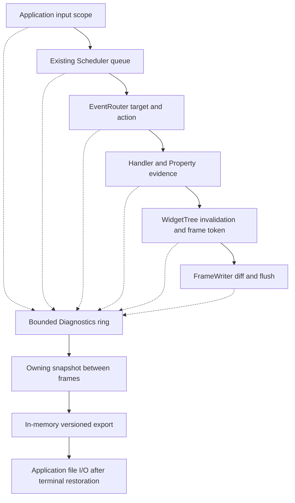

# Diagnostics {#diagnostics}

Portals records bounded metadata to explain an input action, including an action that
returns without requesting a frame. It does not record input characters, paste or
clipboard contents, property values, exception messages, object addresses, or VT
bytes. This metadata is **not** the `PORTALS-TRACE 1` replay format.

## Connect one recorder

```cpp
#include <portals/diagnostics.hpp>

// Keep ordinary error handling around every expected result in application code.
auto trace = std::make_shared<portals::Diagnostics>();
portals::SchedulerOptions options;
options.diagnostics = trace;
auto scheduler = portals::Scheduler::create(options).value();
auto tree = portals::WidgetTree::create(*scheduler).value();
portals::FrameWriter writer(output, {}, trace);
trace->enable({.capacity = 1024}).value();
```

Diagnostics is disabled by default. A null recorder costs a pointer check at a
hook; a configured but disabled recorder adds an enabled-state check. Disabled
hooks do not allocate ring memory, format text, read clocks, increment diagnostic
counters, or inspect input/model payloads. Queue entries have fixed-size token
storage even while recording is disabled. Enabling reserves the ring; recording
never allocates. There is no diagnostic clock: sequence numbers order retained
observations, rather than claiming wall-clock latency. Scheduler's existing clock
and queue metrics retain their original semantics.

The scheduler shares ownership with its endpoints. The tree borrows the scheduler;
the writer shares the recorder. `DiagnosticScope` only borrows it, must remain on
its constructing thread, and must end before the recorder. Scopes restore nested
contexts on normal and exceptional exits. There is no process-wide recorder or
second executor.

## Follow actual input and frames

Create the input token at the application's **decoded input boundary**, before
attempting publication, including an input subsequently rejected by a full queue:

```cpp
{
  portals::DiagnosticScope action(trace.get(),
    trace->beginInput(portals::DiagnosticInput::KEY));
  auto publication = inputPublisher.publish(owningInput);
  // Handle publication.error() normally. Diagnostics never retries delivery.
}
```

The scheduler retains a token with the publication and installs it around the UI
callback. Router target selection, focus changes, semantic action resolution,
handler entry/return, Property equality/commit, and tree invalidation use this same
context. Direct router dispatch/invoke creates its own input scope when none exists.
An application continuation on another thread can install a copied token with
`DiagnosticScope`; a new `beginInput` inside a scope explicitly records its parent.
The context contains no UI pointer and never grants access to a widget.

After bounded scheduler dispatch, consume the ordinary frame request, render the
actual tree, then submit the result with its token:

```cpp
auto requested = tree->consumeFrameRequest().value();
if (requested != portals::Invalidation::NONE) {
  auto frame = renderApplicationTree(); // Uses tree->frame; no terminal I/O here.
  writer.submit(std::move(frame), tree->diagnosticFrame()).value();
  auto outputResult = writer.flush(deadline); // Outside layout/paint.
  // Handle partial progress and errors normally.
}
```

Multiple invalidations coalesce into one frame ID. Each cause writes its own ring
record referring to that frame; no growing list is attached to the tree. The frame
token identifies the first recorded cause, not every cause. Layout's paint-dirty
mark inside an active tree frame belongs to that frame and does not invent another
diagnostic frame request. The output records describe actual `FrameWriter` diff,
submission and flush results. `output_accepted` means complete, consistent transport
acceptance; it is not proof that a physical terminal displayed the frame.

## Interpret evidence conservatively

A synthetic Enter on a focused Button whose callback calls `Property::set` with
an equal value produces these stages (numeric IDs omitted):

```text
input input=key
queue_accepted queue=control
queue_dispatch queue=control
action action=1
target stableNodeId=<tree-session>:<slot>:<generation>
handler_started
property reason=value_unchanged
handler_returned reason=value_unchanged
frame_not_requested reason=frame_not_requested
completed reason=value_unchanged
queue_returned reason=outcome_unknown queue=control
```

`value_unchanged` describes the observed Property operation. It does not assert
that arbitrary external state was unchanged. A user callback without Property
evidence remains `outcome_unknown`, even when it returns normally and requests no
frame. A later `handler_failed` cannot undo an earlier `value_changed` observation.
`frame_not_requested` means that this routing scope observed no new tree frame
request, not that the application had no previously pending frame.

Known reasons include `queue_full`, `replaced`, `cancelled`, `no_target`,
`target_disabled`, `stale_target`, `unbound_action`, `unhandled`, `handler_failed`,
`value_unchanged`, `outcome_unknown`, `frame_not_requested`, `diff_empty` and
`output_failed`. An empty explicit target differs from an ineligible explicit
target. Keyboard focus recovery can select another eligible target; diagnostics
reports what the router actually selected. Node session, slot and generation are
exported together, without addresses. IDs are local to the recorder/tree lifetime,
not portable identities across application runs.

A replaced publication records both the old publication's cancellation and a
fixed-size link from the new publication. Queue metrics are unchanged. The export
cannot establish why input never reached an instrumented application boundary.

## Bounds, periods and incomplete chains

`enable` starts a fresh interval and clears its ring/loss counters. Sequence and
identity counters never reset or wrap. `disable` preserves the retained interval
and its final sequence. A context carried across either boundary is incomplete.
Identity exhaustion permanently stops admission with `identity_exhausted`.

The ring overwrites its oldest record when full (`dropped_overflow`). Producers
try the record lock once and count contention losses (`dropped_contention`) rather
than blocking the UI or changing delivery. Snapshot copying holds the lock; format
and I/O do not. Snapshot memory is bounded by configured capacity. Snapshot analysis
uses bounded scans of retained records; reserve large capacities with care because
completeness analysis is quadratic in capacity in the worst case. Capture between
frames, not in measure/layout/paint.

The snapshot exports interval boundaries, retained sequence range, both loss
counters, saturation, state and `incomplete`. Any known loss conservatively taints
all retained chains. Missing input/completion, outstanding publication/output and
cross-period tokens are also incomplete. Each accepted publication needs its own
`queue_returned` or `queue_cancelled`; entering its callback or finishing another
publication with the same correlation ID does not complete it. A failed callback
records `queue_returned reason=handler_failed` at the scheduler boundary.
This is deliberately conservative: an
absent record is never proof that an action did not happen. No accounting is
performed for disabled hooks.

## Export without damaging a TUI

`exportDiagnostics(snapshot)` returns schema-versioned text in memory; it performs
no file, stream, or terminal I/O. The application chooses a file and owns error
handling. Capture/serialize between frames, or after the terminal has been restored.
Never send the text to stdout/stderr while a native TUI is active.

```cpp
trace->disable();
auto saved = trace->snapshot();
// Restore/close the application's terminal before its final export.
auto text = portals::exportDiagnostics(saved);
std::ofstream file(chosenPath, std::ios::binary | std::ios::trunc);
file << text;
file.close();
if (!file) {
  // Report an export failure through the application's now-safe error channel.
}
```

Snapshot construction and return preserve `std::bad_alloc` propagation, including
Debug iterator-proxy allocations. The return uses a bounded copy outside the lock
to avoid a potentially allocating `noexcept` container move.
Allocation/formatting errors remain visible to the caller; file open, write and
close errors must all be checked. `validateDiagnosticVersion` rejects unsupported
version headers before an application's reader interprets fields; it is a version
check, not a replay parser. The `portals_diagnostics_flow` headless fixture optionally
accepts one export path, writes the real no-effect scenario, and returns 2 for a
file failure. It uses TestTerminal, so it has no active native TUI to corrupt.
Final dashboard wiring and a packaged HTML/export example are integration tasks
for the application consuming this API.

## Implemented flow


