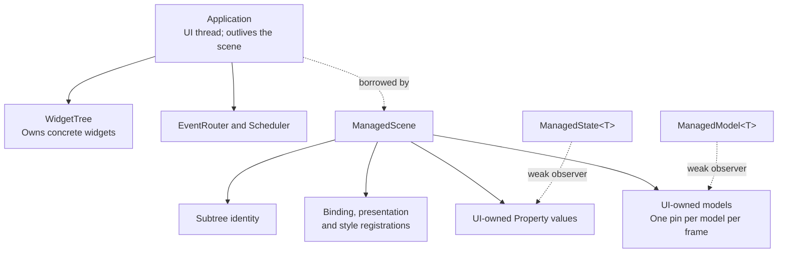

# Managed controls {#managed-controls}

`<portals/managed.hpp>` adds `ManagedScene`, a lifecycle owner for ordinary
controls, custom widgets and opt-in virtual views. It uses the existing
`Application`, `WidgetTree`, properties, bindings, router and style engine. The low-level APIs remain
available. Nodes can be mounted imperatively or through the separate
[declarative composition API](declarative-ui.md). Managed virtual factories add
automatic preparation of lists, tables and charts without introducing
reconciliation, a second widget tree or another runtime.

## Ownership and execution

Create an `Application`, then `ManagedScene::create(application, options)`. The
optional `ManagedOptions` sets positive `maxNodes` (4096 by default),
`maxStates` (256 by default) and `maxModels` (64 by default) limits. Node entries
include removed registrations until the next preparation prunes them; state
owners remain until scene destruction, while model owners remain until close.
Exceeding an owner budget returns a typed `TreeError::NODE_LIMIT`.
Add a `Column`, `Row` or custom layout below `scene.root()`, and create controls with
`scene.emplace<T>(parent, arguments...)`. The returned `Node<T>` remains the
existing checked observer. Concrete custom types may be `final`; no additional
widget base class is required.

The scene is noncopyable, nonmovable and UI-affine. Destroy it before its
`Application`, outside callbacks and tree frames. Removing a child or ancestor
from an admitted callback is supported; destroying either owner from that
callback is not. An admitted callback retains its storage until it returns.

`scene.state<T>(value)` owns the `Property<T>` on the UI thread and returns a
weak `ManagedState<T>`. Copies of the handle do not extend the state owner's
lifetime. `set()` and `snapshot()` return the existing property results; UI
affinity is checked before accessing the property. Use transitively immutable
snapshots for cross-thread data. Do not use the weak handle as a worker-side
mutable model interface.

Call `scene.run()` or `scene.run(terminal)` to retain complete managed errors.
The `Application` still supplies options, width policy and the injected clock.
The terminal overload supports the same deterministic replay contract as
`Application::run`; no native terminal is required for tests.

Normal stop disconnects scene registrations, removes its subtree and destroys
owned models. The scene retains properties until destruction so the caller can
read final property snapshots. Model handles instead report `CLOSED` after stop.
Writes after stop fail because the invalidation target is stale. After scene
destruction, state operations on the creating UI thread return
`TreeError::CLOSED`; wrong-thread operations still return `WRONG_THREAD` before
checking expiration. Copying or destroying a handle is thread independent.
Explicit `close()` is an
idempotent fallible cleanup boundary; the destructor performs RAII cleanup.

## Standard behavior and presentation

`bind(editor, name, result, clipboard, validate)`, `bind(checkbox, enabled,
changed)` and `onClick(button, action)` retain their registrations in the scene.
Ordinary consumer code stores no individual binding tokens and calls no
standard control synchronization functions. The scene obtains focus and
synchronizes standard presentation only at the existing dirty-frame prepare
boundary, before layout and paint. It does not add idle polling.

The property remains authoritative. Initial binding adopts its snapshot, and
latest-snapshot synchronization recovers from rejected notifications. The exact
`PropertyUpdate<T>` receipt still distinguishes a successful commit from failed
notification admission. Resynchronization does not repeat a business callback.
State invalidation must be `PAINT` or `LAYOUT`; `NONE` cannot guarantee this
recovery and is rejected.

Line editing keeps the existing contract:

- Typing changes the local draft; losing focus does not commit it.
- Enter validates and commits only if the source revision still matches.
- Rejected validation or a revision conflict preserves the draft.
- Escape adopts the latest committed value.
- Invalid text and over-limit edits retain the previous draft.

The standard behavior executes before the result callback. Returning a callback
error cannot undo an already committed checkbox toggle or edit. The LineEdit
validator is the explicit commit veto. There is one event registration per node;
`onEvent` is the custom-widget path, not a second registration to stack on a
bound standard control. Callback storage uses `std::function`, so captures must
be copyable; move-only captures are not promised by this version.

## Styles and custom widgets

Standard controls receive the existing `Control` style identity automatically.
Custom widgets use `scene.style(node, target)` and read `computedStyle()` while
painting. Metadata is staged and installed as a batch. `theme(sheet)` uses the
existing atomic style engine, flushing pending registrations before replacing
the sheet. Explicit theme selection and initial focus remain application intent.

One style engine owns a node at a time. Do not bind the same managed node to an
independent `StyleEngine`. The existing precedence remains widget defaults below
matching stylesheet rules; this layer does not introduce a local-override
cascade, hierarchy selectors, inheritance or new PSS syntax.

Register a custom event handler with `onEvent(node, callback)`, returning
`expected<EventReply, TreeError>`. Register custom presentation work once with
`onPrepare(node, callback)`, returning `expected<void, TreeError>`. The latter
receives the concrete widget and the recovered focus observer. It reads domain
state, updates retained presentation when needed and requests the appropriate
invalidation. The scene invokes it; the application does not manually call it
before each frame. Custom `onPrepare` runs before layout and does not supply
virtual-view geometry. Use the dedicated virtual factories for automatic
preparation from the arranged size. Painting must still consume only prepared
presentation.

## Managed virtual views

`model<T>(initialSnapshot, options)` creates an existing `Model<T>` owned by the
scene and returns a weak `ManagedModel<T>`. The handle exposes `publisher()` on
UI so provider code can copy the existing worker-safe publication endpoint.
Snapshots and rows must satisfy the immutable model contract. Handles copied
outside the scene do not extend model ownership, and models cannot be shared
between managed scenes through these factories.

`virtualList`, `virtualTable` and `chart` accept that handle, create independent
range consumers, and register preparation plus the standard `List`, `Table` or
`Chart` style target. Lists and tables also own their standard input bindings.
No per-view token, manual style registration, pin or size calculation is needed.
The usual `style()` and `theme()` operations remain available for customization.

The scene pins each model once during ordinary dirty-frame preparation and uses
that pin for every registered view and bounded layout retry. An optional provider
handler receives borrowed frame/request arguments after each successful view
preparation, in registration order. Copy pending requests before retaining them;
provider scheduling and rejected-completion retry remain application policy.
A missing handler with pending work reports `PREPARE / INVALID_ARGUMENT` and
cancels the unowned request. Do not mutate the managed registry or dispatch the
scheduler from a preparation handler.

Hiding cancels range work; disabling keeps preparation but suppresses input;
removal retires the consumer. Closing the scene destroys model owners and closes
their endpoints. A factory failure removes its attempted child, preserving
earlier children. The [virtual preparation guide](virtual-preparation.md)
describes callback ordering, lifetime, failures and the complete installed
before/after programs. Explicit `ApplicationScene` hooks and low-level preparation
helpers remain supported.

## Errors and partial construction

Managed operations return `expected<..., ManagedError>`. The error retains its
phase, node identity and original `TreeError`, `StyleError` or `ApplicationError`.
It can also retain an independent runner/restoration error and cleanup failure.
The run wrapper is required when the caller needs these complete details;
calling the `ApplicationScene` compatibility hooks directly cannot carry the
whole error object through their `TreeError` return type.

Business callbacks return their errors explicitly. Throwing from a callback
still follows the existing `CALLBACK_FAILED` boundary; using `.value()` there
would discard the original expected error. The scene-level `onInput` callback
returns `expected<bool, ManagedError>` so a failed theme replacement can retain
its full style error. `true` consumes the event before routing. Mutable captures
retain their state between events. Replacing the interceptor or closing the
subtree from inside it retains the active callback until it returns.

An admitted custom preparation callback may remove its own node. Successful
removal does not suppress an explicitly returned error or a translated exception.
Checked insertion also revalidates its result after deferred unmount callbacks
have run; it cannot return a child already removed by that cleanup.

Failed construction removes the attempted child; earlier successful children
remain scene-owned. Destroying the scene cleans a partially built form. This is
resource cleanup, not rollback of external effects performed by constructors,
mount hooks or business callbacks.

## Installed consumer and Gate B

The existing package test relocates the installation, copies the complete
`tests/package_consumer` directory, configures it using `find_package(Portals
0.2 CONFIG REQUIRED)`, and links only `portals::core`. No private header or
source-tree include is needed. Its original model/custom-widget test remains.

The complete before and managed programs included below use the same final
`Meter`, domain messages, palette, dimensions and deterministic replay. Shared
fixture files provide the custom widget, test observations and terminal adapter;
they contain no hidden control registration or standard presentation sync.
Setup helpers terminate on assertion failure and are test policy, not a proposed
production error-reporting API. Application callbacks propagate typed failures.

| Consumer responsibility | Before | Managed |
|---|---:|---:|
| Separately retained binding tokens, including custom input | 4 | 0 |
| Explicit standard style registrations | 5 | 0 |
| Custom style identity declarations | 1 | 1 |
| Focus snapshot reads per prepare | 1 | 0 |
| Standard synchronization calls per prepare | 6 | 0 |
| Explicit initial focus and palette choice | Present | Present |
| Custom presentation/input policy | Present | Present |

The replay checks each intermediate state: draft before Enter, one successful
commit, checkbox two-way state, Run reading committed state, Tab traversal,
custom level adjustment, F2 palette change, empty-value validation, Escape
reset, external-update conflict, rejected notification recovery without another
business callback, invalid UTF-8, and custom self-removal. F10 stops the run.

`consumer.form-before` and `consumer.form-after` execute these assertions.
`consumer.form-equivalence` additionally compares the entire captured terminal
byte stream and domain summary. Hex output keeps terminal escape sequences out
of test logs. `consumer.form-typed-error` returns a deliberate
`INVALID_GEOMETRY` from a business callback and checks the original cause,
phase, node and transport cleanup.

These tests cover the bounded P1.1 form/custom-widget scenario. They do not
constitute the full future Gate B matrix for lists, tables, charts or every
control family, and passing them is not user acceptance. Execution results and
the tested configuration belong in the integration report. No runtime speedup,
compile-time improvement or large-form performance claim follows from removing
manual obligations; those require separate measurements.

## Complete before and after programs

Both source files below contain `main()` and are separate executables. Build
them with the installed-consumer CMake project described above, using the same
installed `portals::core` target. Keep `form_support.hpp` and `form_replay.hpp`
beside both programs. These shared fixture files are included in full below:
they provide identical domain rendering, observations and replay input, while
the two `.cpp` files show all registration and lifecycle differences.

### Before: explicit binding ownership and presentation synchronization

[Open the complete source](../tests/package_consumer/form_before.cpp).
The generated HTML reference embeds these files below with line numbers.

\include{lineno} form_before.cpp

### After: scene-owned lifecycle

[Open the complete source](../tests/package_consumer/form_after.cpp).

\include{lineno} form_after.cpp

### Shared custom widget and behavioral assertions

[Open the shared widget and assertions](../tests/package_consumer/form_support.hpp).

\include{lineno} form_support.hpp

### Shared deterministic terminal and input sequence

[Open the replay fixture](../tests/package_consumer/form_replay.hpp).

\include{lineno} form_replay.hpp
